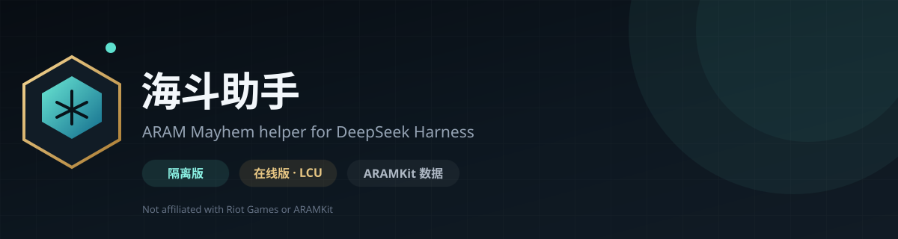

# 海斗助手 · DSH 插件



**《英雄联盟》海克斯大乱斗（ARAM Mayhem）的 DSH 插件：查数据、看结算，还能让 AI 在游戏里陪你打。**

两个版本：

- **海斗助手隔离版**：不连接游戏客户端，手动查询隐藏分、出装和海克斯。
- **海斗助手在线版**：连接 League Client 的 LCU 本地接口，选人、局内、结算全程自动；v1.1.0 起带**游戏内悬浮窗**，AI 按你的人设每 3–4 分钟说一句，赛后还能锐评队友。

数据来自 [ARAMKit](https://aramkit.cn/zh-CN)。本项目不是 Riot Games、腾讯或 ARAMKit 的官方产品。

> **v1.1.1 重点**
>
> - 现代水墨电竞 UI：宣纸暖白、浓淡墨、朱砂印章、古金数字、松烟青绿连接态；
> - 游戏内悬浮窗平时只占一个 80px 圆形入口，点开才显示三个功能；
> - 解说独立窗口，默认 10 秒、可设 3–30 秒，自动消失；
> - 3–4 分钟随机开口，3 段游戏 + 1 段女友型关心循环；
> - 完整人设 + 随机情绪落点 + 口癖，像女朋友在旁边，而不是解说员；
> - 直接看图，不创建 DSH 会话，一条约 0.2 分钱。

当前版本：

| 插件 | 版本 | 路径 |
|---|---|---|
| 海斗助手隔离版 | v1.0.9 | `packages/aramkit-helper` |
| 海斗助手在线版 | v1.1.1 | `packages/aramkit-live` |

---

## 目录

- [功能对比](#功能对比)
- [环境要求](#环境要求)
- [安装](#安装)
- [给使用者的安装说明](docs/USER-GUIDE.md)
- [发布 Release](docs/RELEASES.md)
- [用 GitHub Desktop 发布](docs/GITHUB-DESKTOP.md)
- [使用](#使用)
- [在线版连接 LCU](#在线版连接-lcu)
- [AI 锐评](#ai-锐评)
- [游戏内实时解说](#游戏内实时解说)
- [对局记录](#对局记录)
- [数据与隐私](#数据与隐私)
- [常见问题](#常见问题)
- [项目结构](#项目结构)
- [开发](#开发)
- [架构说明](docs/ARCHITECTURE.md)
- [更新日志](#更新日志)
- [免责声明](#免责声明)
- [License](#license)

---

## 功能对比

### 数据与对局

| 能力 | 隔离版 | 在线版 |
|---|---|---|
| 队友隐藏分 | 手动输入 Riot ID 查询 | 选人时自动读取五名队友 |
| 可选英雄 | — | 自动读取本局候选池，推荐胜率前 5 |
| 英雄出装 / 召唤师技能 | 搜索英雄后查看 | 自动识别当前英雄 |
| 英雄流派切换 | 暴击 / 战士 / 特效等 | 同左 |
| 海克斯推荐 | 棱彩 / 黄金 / 白银各前 3，可展开前 15 | 同左，自动跟随英雄 |
| 海克斯组合 | 显示高胜率组合 | 显示高胜率组合 |
| 全分段 / 高分段 | 支持切换 | 当前使用全分段 |
| 局内查看自己的推荐 | — | 支持，Alt-Tab 切出游戏也能看 |
| 结算数据 | — | 自动读取 KDA、伤害、经济等 |
| 结算海克斯明细 | — | 悬浮图标查看名称、品质和说明 |
| 对局记录 | — | 保留最近 24 小时，含结算数据与该局锐评，开下一局不丢 |

### 游戏内 AI

| 能力 | 隔离版 | 在线版 |
|---|---|---|
| 游戏内悬浮窗 | — | v1.1.0 起，宣纸底 + 头像 + 气泡 |
| 实时陪伴解说 | — | v1.1.0 起，3–4 分钟随机，按人设/口癖说话 |
| 解说人设 | — | 4000 字自定义，支持情绪落点 / 口癖 / 示例台词 |
| 画面门禁 | — | 只在游戏窗口未最小化时抓帧 |
| 手动抓帧 `aram_peek` | — | 支持 |
| 赛后 AI 锐评 | — | 友方五人，毒舌 / 教练 / 抽象 / 数据复盘 / 自定义 |
| AI 锐评开关 | — | 可关闭，不消耗 Token |
| 锐评语料预设 | — | 虎扑毒舌 / 海斗专业分析 / 专业抓处 |

### 适合谁

**隔离版**：

- 不想让插件读取客户端；
- 只想在选人前后手动查数据；
- 客户端不是 WeGame / Riot 默认安装方式；
- 只想看某个英雄的出装和海克斯。

**在线版**：

- 想少操作，选人时自动出结果；
- 想在对局中切出来看自己英雄的推荐；
- 想在对局结束后直接看结算和 AI 锐评；
- 想要一个游戏内悬浮窗，按自己的人设陪你打、每 3–4 分钟说一句；
- 想控制 AI 开销，或自定义锐评风格和语料。

---

## 环境要求

- Windows 10 / 11
- DeepSeek Harness Desktop（DSH），且 Web UI 可用
- Node.js 22+（仅本机安装插件时需要）
- 在线版额外需要：
  - 已启动并登录的 League 客户端
  - 国服账号（隐藏分查询覆盖国服）
  - DSH 已配置默认模型（AI 锐评、实时解说需要）
  - **游戏内悬浮窗需要 Python 3**（自动查找 `%LOCALAPPDATA%\Programs\Python\Python312\python.exe`；
    也可用 `DSH_SEE_PYTHON` 指定）

> 隔离版不是游戏内悬浮窗；在线版 v1.1.0 起带游戏内悬浮窗，DSH 面板仍然可以放在副屏查看。

---

## 安装

### 方式 A：Release ZIP（推荐给普通用户）

1. 下载 `release/aramkit-live.zip`（或 GitHub Release 里的同名附件）；
2. 解压到一个固定目录，例如 `D:\DSH\aramkit-live`；
   - 解压后应直接看到 `package.json`、`index.js`、`tools/`、`assets/`；
3. 在 DSH 的插件管理器里选「从本地目录安装」，指向该目录；
   或者用命令行：

```powershell
dsh plugin --profile desktop add "link:D:\DSH\aramkit-live"
```

ZIP 已包含 `tools/`（悬浮窗、OCR、抓帧）和 `assets/`，不需要再单独下载。

### 方式 B：克隆仓库

```bash
git clone https://github.com/<your-name>/aramkit-dsh-plugins.git
cd aramkit-dsh-plugins
```

也可以直接用 GitHub Desktop：

1. 打开 GitHub Desktop；
2. **File → Clone repository**；
3. 选择本仓库；
4. 选择一个固定目录，例如 `D:\DSH\aramkit-dsh-plugins`。

### 安装 bundle

方式 A（ZIP）直接在 DSH 插件管理器里选择解压目录即可，或在终端执行：

```powershell
dsh plugin --profile desktop add "link:D:\DSH\aramkit-live"
```

方式 B（源码）在仓库根目录执行：

```bash
# 隔离版
dsh plugin --profile desktop add "link:<仓库绝对路径>\packages\aramkit-helper"

# 在线版
dsh plugin --profile desktop add "link:<仓库绝对路径>\packages\aramkit-live"
```

把 `<仓库绝对路径>` 换成实际路径，例如：

```text
D:\DSH\aramkit-dsh-plugins\packages\aramkit-helper
D:\DSH\aramkit-dsh-plugins\packages\aramkit-live
```

> `desktop` 是常见的 DSH profile 名称。如果你的 profile 不叫 `desktop`，请替换成实际名称。安装完成后重启 DSH，或刷新 Web 页面。
>
> 如果终端提示 `dsh` 不是内部或外部命令，请使用 DSH 安装目录里的 `dsh.exe`，或把 DSH 的安装目录加入 PATH。你的 DSH 版本如果提供“从本地目录安装插件”的界面，也可以直接选择 `packages/aramkit-helper` 或 `packages/aramkit-live`。

### 确认安装

刷新 DSH Web 页面后，左侧栏底部会出现两个六边形图标：

- **海斗助手隔离版**
- **海斗助手在线版**（带绿点）

如果只看到一个，检查终端输出里是否有安装错误。

### 把安装说明发给别人

可以直接把 [docs/USER-GUIDE.md](docs/USER-GUIDE.md) 发给使用者；它是不需要改代码的纯安装/使用说明。

发布 ZIP 包的流程见 [docs/RELEASES.md](docs/RELEASES.md)。

### 用 GitHub Desktop 发布

如果你要修改后重新上传，见 [docs/GITHUB-DESKTOP.md](docs/GITHUB-DESKTOP.md)。

---

## 使用

### 隔离版

1. 点击左侧栏 **海斗助手隔离版**。
2. **队伍隐藏分**：
   - 输入你的 `昵称#Tag`，点“查询我的队伍”；
   - 会读取最近一局同队五人的隐藏分；
   - 也可以展开“手动查询队友”，逐个查当前队友。
3. **英雄推荐**：
   - 搜索并选择英雄；
   - 顶部切换 **全分段 / 高分段**；
   - 查看出装顺序、召唤师技能、技能加点；
   - 海克斯按 **棱彩 / 黄金 / 白银** 标签切换，默认前 3，点箭头展开前 15。
4. 页面右上角的 `EN / 中文` 可以切换界面语言，默认中文。

### 在线版

1. 先启动 League 客户端并登录。
2. 点击左侧栏 **海斗助手在线版**。
3. 进入选人阶段后，页面会自动显示：
   - 本局可选英雄；
   - 胜率最高的 5 个；
   - 五名队友的隐藏分；
   - 你当前英雄的出装、召唤师技能、海克斯。
4. 进入游戏后，页面会保留 **你的英雄**：
   - 只显示你自己选择的英雄推荐；
   - 不再占用空间显示五名队友的出装；
   - 即使 Alt-Tab 切出游戏、选人界面已关闭，也能查看。
5. 对局结束后：
   - 自动读取结算数据；
   - 展示友方五人的 KDA、伤害、承伤、经济、治疗、控制、视野；
   - 自动调用 AI 生成 **尽力 / 犯罪 / 不团队** 锐评；
   - 失败可以点“重新锐评”。
6. 游戏内悬浮窗：
   - 打开左侧栏 **海斗助手在线版**，在「全程解说」里打开开关并保存人设；
   - 悬浮窗在这时才出现（DSH 启动时不会自动弹）；每 3–4 分钟随机说一句；
   - 关掉在线版页面，悬浮窗一起收起；
   - 切到桌面并最小化游戏时会自动停，不会读桌面。

---

## 在线版连接 LCU

在线版通过 League Client 的本地 LCU 接口读取数据，**只读**，不修改客户端、不注入游戏进程。

### 自动发现顺序

1. 环境变量 `ARAMKIT_LCU_LOCKFILE` 指定的路径；
2. 常见 Riot / WeGame 安装目录的 `lockfile`；
3. 最新的 `LeagueClientUx.log` 中记录的端口和令牌；
4. `LeagueClientUx.exe` 的启动命令行。

### WeGame 用户

WeGame 版的 `D:\WeGameApps\英雄联盟\LeagueClient\lockfile` 有时会是 **0 字节的旧文件**，这是正常的。在线版会自动从 `LeagueClientUx.log` 恢复连接。

如果自动恢复失败：

1. 打开任务管理器，确认 **LeagueClientUx.exe** 正在运行；
2. 右键 → 打开文件所在的位置；
3. 如果该目录的 `lockfile` 不是 0 字节，把完整路径填到页面的「手动指定 lockfile」；
4. 或者点「自动扫描」，选择标记为 `✓` 的路径。

### 手动指定

在线版页面在未连接时会显示「手动指定 lockfile」：

```text
C:\WeGameApps\英雄联盟\LeagueClient\lockfile
```

路径必须精确到 `lockfile` 文件。0 字节文件会提示：

```text
文件是 0 字节：LeagueClientUx 还没启动或还没登录
```

### 环境变量

如果不想每次填路径，可以设置：

```text
ARAMKIT_LCU_LOCKFILE=D:\WeGameApps\英雄联盟\LeagueClient\lockfile
```

然后重启 DSH。

> **不要**把 `Riot Client Data\User Data\Config\lockfile` 填进来。那是 Riot Client 的 lockfile，不提供 `/lol-*` 接口。

---

## AI 锐评

在线版的 AI 锐评使用 DSH 当前配置的默认模型：

- 在 DSH 设置中配置好默认模型；
- 对局结束后，结算出现时自动跳到「对局记录」，宿主在后台生成锐评并写入这条记录，开下一局也不会丢；
- 只评价友方五人，不评价敌方；
- 标签为 **尽力 / 犯罪 / 不团队**；
- 评论会引用伤害占比、经济、KDA、承伤、治疗、控制、视野等数据；
- 会结合每个人选择的海克斯，评价选择是否契合英雄和阵容；
- 治疗只统计对队友的治疗，自身吸血/自愈不计入团队贡献；
- 同一局、同一风格和语料再次请求会直接复用记录里的结果，不重复消耗；点「重新锐评」才会重新生成；
- 在「AI 锐评设置」里可以**关闭 AI**，关闭后只显示结算面板，不消耗 Token；
- 页面右上角也有 **AI 锐评 开/关**，可以在进游戏前先关掉；
- 支持 **毒舌锐评 / 温和教练 / 抽象整活 / 数据复盘 / 自定义** 五种风格；
- 语料预设内置 **虎扑毒舌 / 海斗专业分析 / 专业抓处** 三套，选中会覆盖语料并自动切到「自定义」风格，之后仍可继续修改；
- 可以填写自定义语料、常用梗、禁用词或额外要求，作为风格参考；
- 游戏内悬浮窗也能直接点「赛后锐评」：请求 `/aramkit-live/review` 生成，
  完成后在覆盖层显示摘要和五人一句话锐评，完整内容仍在插件面板 / 对局记录里。

如果 AI 报错：

- 检查 DSH 是否已配置默认模型；
- 检查模型余额 / 网络；
- 在记录详情里点“重新锐评”。

> AI 生成的内容仅代表模型观点，不是官方评价。

---

## 游戏内实时解说

v1.1.0 新增。在线版会在游戏里放一个置顶悬浮窗，AI 按你写的人设陪你打，
每隔 3–4 分钟随机说一句。

### 开启

1. 打开左侧栏「海斗助手在线版」；
2. 在「全程解说」里打开开关；
3. 把完整人设粘进文本框（上限 4000 字）；
4. 打开在线版页面后进入对局，悬浮窗才会出现在屏幕右上角；关掉页面时一起收起，DSH 启动时不会自动弹。

人设建议写清楚：名字、年龄、职业、称呼、口癖、生气/撒娇时的反应、几句示例台词。
没有固定模板，越具体越像那个人。

### 它怎么说话

- **不是解说员**：prompt 明确“你是女朋友，游戏只是背景”，优先关心人；
- **懂模式**：明确这是海克斯大乱斗——5v5 单线、没有打野、不能主动回城、买装备只能等阵亡；
  不会再说“打野来抓”“回家买装备”“小龙/先锋”；
- **会看时间**：右上角是**本局游戏时长**，不是现实时间；
- **情绪落点随机**：挑刺 / 护短 / 吃醋 / 心疼 / 日常联想 / 夸完补损 / 撒娇 / 假装不耐烦；
- **口癖随机**：啧、哎、你看你、真是的、行吧、我跟你讲、笨死了、嗯？，一条最多 1–2 个；
- **避免重复**：每次带最近 3 条解说作为“别说过了”的锚点；
- **小圆形入口**：平时只占一个 80px 真圆钮（Windows 透明色抠掉四角），点开才出现三个功能；
- **解说独立窗口**：气泡不和三个按钮连在一起，默认显示 **10 秒**，可在插件页设成 3–30 秒，到点自动消失；
- **字体清晰**：Tk 启动前声明 DPI 感知、按实际 DPI 校正，正文/标题用负数字号按像素渲染（14/16px），窗口不再用 0.97 半透明；
- **微信/QQ 连发**：每段只输出 1 条短消息（10–30 字），画成一个气泡；每 4 段一个循环，
  **前 3 段聊游戏、第 4 段只关心/撒娇**，不是一段里塞四句；
- **局内高光即时插话**：双杀 / 三杀 / 四杀 / 五杀、一血、团灭、5/10/15 杀里程碑会立刻说一句，
  15 秒冷却，不必等 3–4 分钟的普通节拍。
  > Live Client API 不提供“对英雄伤害”字段，所以“高额伤害”目前用连杀 / 击杀里程碑做代理，
  > 不编具体伤害数字。

### 画面门禁

只有游戏窗口存在且**没有最小化**时才抓帧：

- 游戏在后台、DSH 在副屏 / 前台 → 照常解说；
- 游戏最小化、切到桌面 → 跳过，不会对着桌面截图说话；
- `aram_peek` 也会拒绝抓帧。

### 成本

按 `deepseek-flash` 官方价格估算：直接看图一条约 **0.15–0.35 分**，
20 分钟一局约 **3–9 分钱**。不创建 DSH 会话、不累积历史，所以不会越打越贵。
价格以 [DeepSeek 官方页面](https://api-docs.deepseek.com/zh-cn/quick_start/pricing/) 为准。

### 诊断接口

- `GET /aramkit-live/commentary-status`：解说开关、阶段、画面门禁、覆盖层状态；
- `GET /aramkit-live/test-direct-comment`：立刻生成一条，返回 `{ok,text}` 或错误；
- `POST /aramkit-live/comments {text}`：手动发一条解说。

---

## 对局记录

- 顶部「本局 / 对局记录」随时切换，不打断当前对局；
- 结算一出现就自动跳到记录并打开这一局，锐评还在生成也能先看结算；
- 只保留最近 24 小时，每局记录包含胜负、时长、你的英雄和 KDA、五人结算表、海克斯和该局锐评；
- 记录保存在 `%USERPROFILE%\.dsh\aramkit-live\history.json`（设置了 `DSH_HOME` 时放在其下），只在本机，不上传；
- 锐评在后台生成，切页面、开下一局都不影响；生成中会自动刷新，失败可以手动重试。

---

## 数据与隐私

### 数据来源

- 英雄胜率、出装、召唤师技能、海克斯：ARAMKit 公开数据端点；
- 隐藏分：ARAMKit 隐藏分查询接口；
- 选人 / 结算 / 局内阵容：本机 LCU 和 Live Client API。

### 隐私

- 隔离版只向 ARAMKit 发送你输入的 Riot ID；
- 在线版会向 ARAMKit 发送队友的 `昵称#Tag` 以查询隐藏分；
- 在线版只在本机读取 LCU 的端口、令牌和比赛数据，**不会上传令牌**；
- AI 锐评会把本局友方数据（包括玩家名、英雄、KDA、伤害、经济等）发送给 DSH 配置的模型；
- 开启实时解说后，**游戏画面帧会发送给 DSH 配置的模型**；这是生成解说的必要输入，帧只在本机抓取，不经过本项目作者的服务器；
- 解说、评论、人设都保存在 `%USERPROFILE%\.dsh\aramkit-live\` 下，只在本机；
- 插件没有额外遥测，不会把数据发送到本项目作者的服务器。

如果不希望队友名字被发送给模型，可以修改 `packages/aramkit-live/index.js` 中的 `formatReviewData`，把 `name` 改成匿名编号。

### 声明

- 隐藏分是 ARAMKit 基于对局数据的估算，不是 Riot 官方 MMR；
- 组队会影响准确性；
- 隐藏分查询只覆盖国服；
- 高分段样本通常少于全分段，低样本过滤仍然生效。

---

## 常见问题

### 1. 左侧栏没有图标

- 刷新 DSH Web 页面；
- 重启 DSH；
- 确认安装命令输出没有错误；
- 打开 DSH 的插件管理器，确认 bundle 已启用。

### 2. 在线版显示“未检测到客户端”

- 确认 League 客户端已启动并登录，不只是打开 WeGame；
- 点击「重试连接」；
- 点击「自动扫描」，选择 `✓` 的路径；
- WeGame 用户优先让插件自动从日志恢复；
- 仍失败时，手动填入非 0 字节的 `lockfile`。

### 3. lockfile 是 0 字节

说明 `LeagueClientUx.exe` 还没真正启动或还没登录。0 字节文件不能用。先进入游戏大厅，再重新扫描。

### 4. AI 锐评失败

- 检查 DSH 默认模型；
- 检查余额和网络；
- 点“重新锐评”；
- 如果模型输出被截断，插件会自动重试一次。

### 5. 高分段数据很少

高分段样本天然少于全分段。插件默认过滤海克斯少于 200 场、出装少于 500 场的样本；没有足够样本时会显示“暂无数据”。

### 6. 游戏里没有解说气泡

1. 确认「全程解说」是开的；
2. 确认游戏窗口没有最小化（窗口在后台、DSH 在前台都可以）；
3. 打开 `/aramkit-live/commentary-status` 看 `enabled / phase / foreground / overlay`；
4. 如果 `overlayRunning` 是 false，重启 DSH；仍有问题看
   `%USERPROFILE%\.dsh\aramkit-live\overlay-error.log`。

### 7. 出现两个悬浮窗

v1.1.0 已用 Windows 命名互斥量做单实例，并在启动前读取 `.cache/overlay.pid` 复用旧窗口。
如果还能看到两个，说明其中一个是旧版本残留进程：重启 DSH 即可清掉。

### 8. 解说太像游戏播报 / 没有人设感

- 确认人设没有被截断（输入框上限已从 300 字放宽到 4000 字）；
- 人设写具体：称呼、口癖、生气/撒娇时的反应、几句示例台词；
- 还是不对的话，把最近 2–3 条解说发出来，调 prompt 里的情绪落点和口癖。

### 9. 会不会被封号

插件只读 LCU 和 Live Client API，不修改客户端、不注入游戏进程、不读内存。但 LCU 是 Riot 未公开的本地接口，使用第三方工具仍有理论风险，请自行判断并遵守游戏条款。

### 10. 海克斯面板收起后又自己弹出来

v1.1.0 已修：手动收起「海克斯识别」会写一条 `cancel` 给服务端，结束这一轮扫描；
本地也会记住「用户已收起」，后续扫描结果不会再自动展开面板。

### 11. 赛后锐评按钮点了没反应

旧版覆盖层把 DSH 的 origin 存成了固定值，DSH 重启换端口后就 POST 到失效地址。
v1.1.0 起插件页每次心跳都会上报当前 `webBase`；按钮失败也会在气泡里显示原因。
如果仍无反应，看 `/aramkit-live/commentary-status` 和 `overlay-error.log`。

---

## 项目结构

```text
aramkit-dsh-plugins/
├─ README.md
├─ LICENSE
├─ .gitignore
├─ docs/
│  └─ ARCHITECTURE.md
└─ packages/
   ├─ aramkit-helper/        # 海斗助手隔离版
   │  ├─ index.js            # Host：ARAMKit 代理 + 数据裁剪
   │  ├─ client.js           # Client：侧栏 + 主面板 UI
   │  ├─ package.json
   │  ├─ cordis.patch.yml
   │  ├─ locale/
   │  ├─ icon.svg
   │  └─ README.md
   └─ aramkit-live/          # 海斗助手在线版
      ├─ index.js            # Host：LCU 状态、AI 锐评、解说循环、HTTP 路由
      ├─ client.js           # Client：选人 / 局内 / 结算 / 解说设置
      ├─ data.js             # ARAMKit 数据访问
      ├─ lcu.js              # LCU / Live Client 连接器
      ├─ comments-service.js # 解说流（人设、评论持久化）
      ├─ hexscan-service.js  # 海克斯识别 + 悬浮窗生命周期
      ├─ peek-tool.js        # aram_peek 工具（抓帧 + say）
      ├─ game-window.js      # 画面门禁（游戏窗口是否可见）
      ├─ src/augment-match.js
      ├─ tools/hexscan.mjs
      ├─ tools/hexoverlay.py
      ├─ tools/ocr.ps1
      ├─ assets/whale-girl.png
      ├─ assets/launcher.png     # 圆形悬浮球头像
      ├─ locale/
      ├─ package.json
      ├─ cordis.patch.yml
      └─ README.md
```

---

## 开发

### 本地修改

两个插件都是普通 JavaScript，没有构建步骤：

- Host 半：`index.js`、`data.js`、`lcu.js`
- Client 半：`client.js`

修改后：

- Host 代码通常需要重启 DSH 或重新安装 bundle；
- Client 代码刷新页面即可（如果 DSH 的开发 watcher 正在运行，也可能自动重载）。

### 安装本地 bundle

```bash
dsh plugin --profile desktop add "link:<绝对路径>\packages\aramkit-helper"
dsh plugin --profile desktop add "link:<绝对路径>\packages\aramkit-live"
```

### 代码约定

- 不修改游戏客户端文件；
- 不注入游戏进程；
- 不提交 `lockfile`、日志、token、`node_modules`；
- 不把 LCU token 发送到任何远程服务；
- AI 请求只通过 DSH 的 LLM 服务发起。

---

## 更新日志

### v1.1.1（2026-11-13）

- 主面板升级为「现代水墨电竞」：宣纸暖白、浓淡墨、朱砂印章、古金数字、松烟青绿连接态；
- 页头换成 DeepSeek 鲸鱼娘六边形品牌头像；
- 游戏内悬浮窗改成 80px 圆形入口，点开才显示三个功能；在 2x 基础上缩小 25%；
- 解说气泡改为独立窗口，默认 10 秒、可设 3–30 秒，到点自动消失；
- 每 4 段解说按「3 段游戏 + 1 段女友型关心」循环，单段一个气泡；
- 修复 DSH 重启换端口后赛后锐评按钮无反应，锐评结果直接在覆盖层显示。

### v1.1.0（2026-11-12）

- 新增游戏内实时陪伴解说：置顶悬浮窗 + 3–4 分钟随机开口；
- 解说改为**直接看图**：`ctx.llm.stream` + `{ type:'image', attachment }`，不创建 DSH 会话；
- prompt 强化人设：完整人设、随机情绪落点、随机口癖、最近 3 条去重、陪伴优先；
- 新增 `aram_peek` 工具与 `/aramkit-live/comments` 手动接口；
- 新增画面门禁：只在游戏窗口未最小化时抓帧；
- 悬浮窗单实例 + pid 复用，修复 DSH 重启后两个悬浮窗；
- 悬浮窗不再随 DSH 启动自动打开：必须打开「海斗助手在线版」页面后才显示，关闭页面一起收起；
- 修复收起海克斯面板后又被扫描结果顶开；
- 修复 DSH 重启换端口后「赛后锐评」按钮无反应；失败会在 overlay 显示原因；
- 新增局内高光即时解说：多杀 / 一血 / 团灭 / 5·10·15 杀里程碑，15 秒冷却；
- 悬浮窗改成 80px 圆形入口，点开才显示三个功能；解说改为独立窗口，默认 10 秒可调；
- 人设输入上限 300 → 4000 字；
- 新增 `/commentary-status`、`/test-direct-comment` 诊断接口。

### v1.0.15

- 选人 / 局内 / 结算、队友隐藏分、出装海克斯推荐、赛后 AI 锐评、对局记录。

---

## 免责声明

本项目不是 Riot Games、腾讯、League of Legends 或 ARAMKit 的官方产品，也不受其认可。

英雄联盟和 Riot Games 是 Riot Games, Inc. 的商标或注册商标。ARAMKit 的数据归其所有者所有。

使用本插件产生的任何后果由使用者自行承担。请遵守游戏服务条款和当地法律。

---

## License

MIT License。详见 [LICENSE](LICENSE)。

如果你要发布自己的修改版，建议保留原仓库链接和 ARAMKit 的署名。
