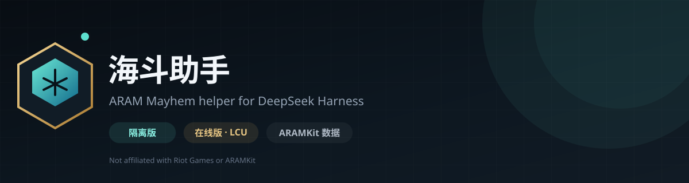

# 海斗助手 · DSH 插件



两个用于《英雄联盟》海克斯大乱斗（ARAM Mayhem）的 [DeepSeek Harness](https://github.com/deepseek-ai) Web UI 插件：

- **海斗助手隔离版**：不连接游戏客户端，手动查询隐藏分、出装和海克斯。
- **海斗助手在线版**：连接 League Client 的 LCU 本地接口，选人、局内、结算全程自动。

数据来自 [ARAMKit](https://aramkit.cn/zh-CN)。本项目不是 Riot Games、腾讯或 ARAMKit 的官方产品。

当前版本：

| 插件 | 版本 | 路径 |
|---|---|---|
| 海斗助手隔离版 | v1.0.9 | `packages/aramkit-helper` |
| 海斗助手在线版 | v1.0.13 | `packages/aramkit-live` |

---

## 目录

- [功能对比](#功能对比)
- [环境要求](#环境要求)
- [安装](#安装)
- [给使用者的安装说明](docs/USER-GUIDE.md)
- [发布 Release](docs/RELEASES.md)
- [用 GitHub Desktop 发布](docs/GITHUB-DESKTOP.md)
- [使用](#使用)
- [在线版连接 LCU](#在线版连接-lcu)
- [AI 锐评](#ai-锐评)
- [数据与隐私](#数据与隐私)
- [常见问题](#常见问题)
- [项目结构](#项目结构)
- [开发](#开发)
- [架构说明](docs/ARCHITECTURE.md)
- [免责声明](#免责声明)
- [License](#license)

---

## 功能对比

| 功能 | 隔离版 | 在线版 |
|---|---|---|
| 队友隐藏分 | 手动输入 Riot ID 查询 | 选人时自动读取五名队友 |
| 可选英雄 | — | 自动读取本局候选池，推荐胜率前 5 |
| 英雄出装 / 召唤师技能 | 搜索英雄后查看 | 自动识别当前英雄 |
| 英雄流派切换 | 暴击 / 战士 / 特效等 | 同左 |
| 海克斯推荐 | 棱彩 / 黄金 / 白银各前 3，可展开前 15 | 同左，自动跟随英雄 |
| 海克斯组合 | 显示高胜率组合 | 显示高胜率组合 |
| 全分段 / 高分段 | 支持切换 | 当前使用全分段 |
| 局内查看自己的推荐 | — | 支持，Alt-Tab 切出游戏也能看 |
| 结算数据 | — | 自动读取 KDA、伤害、经济等 |
| 结算海克斯明细 | — | 悬浮图标查看名称、品质和说明 |
| AI 锐评友方五人 | — | 等待 match history 后结合数据与海克斯选择 |
| AI 锐评开关 | — | 可关闭，只显示结算，不消耗 Token |
| AI 锐评风格 / 语料 | — | 支持毒舌、教练、抽象、数据复盘和自定义语料 |
| 需要 League 客户端 | 否 | 是（同一台 Windows） |
| 需要 DSH 默认模型 | 否 | AI 锐评功能需要 |

### 隔离版

适合：

- 不想让插件读取客户端；
- 只想在选人前后手动查数据；
- 客户端不是 WeGame / Riot 默认安装方式；
- 只想看某个英雄的出装和海克斯。

### 在线版

适合：

- 想少操作，选人时自动出结果；
- 想在对局中切出来看自己英雄的推荐；
- 想在对局结束后直接看结算和 AI 锐评；
- 想控制 AI 开销，或自定义锐评风格和语料。

---

## 环境要求

- Windows 10 / 11
- DeepSeek Harness Desktop（DSH），且 Web UI 可用
- Node.js 22+（仅本机安装插件时需要）
- 在线版额外需要：
  - 已启动并登录的 League 客户端
  - 国服账号（隐藏分查询覆盖国服）
  - DSH 已配置默认模型（AI 锐评需要）

> 插件是 DSH Web UI 插件，不是游戏内悬浮窗。在线版的局内页面需要切到 DSH 或放在副屏查看。

---

## 安装

### 1. 克隆仓库

```bash
git clone https://github.com/<your-name>/aramkit-dsh-plugins.git
cd aramkit-dsh-plugins
```

也可以直接用 GitHub Desktop：

1. 打开 GitHub Desktop；
2. **File → Clone repository**；
3. 选择本仓库；
4. 选择一个固定目录，例如 `D:\DSH\aramkit-dsh-plugins`。

### 2. 安装插件

DSH 的插件以本地 bundle 方式安装。打开终端，在仓库根目录执行：

```bash
# 隔离版
dsh plugin --profile desktop add "link:<仓库绝对路径>\packages\aramkit-helper"

# 在线版
dsh plugin --profile desktop add "link:<仓库绝对路径>\packages\aramkit-live"
```

把 `<仓库绝对路径>` 换成实际路径，例如：

```text
D:\DSH\aramkit-dsh-plugins\packages\aramkit-helper
D:\DSH\aramkit-dsh-plugins\packages\aramkit-live
```

> `desktop` 是常见的 DSH profile 名称。如果你的 profile 不叫 `desktop`，请替换成实际名称。安装完成后重启 DSH，或刷新 Web 页面。
>
> 如果终端提示 `dsh` 不是内部或外部命令，请使用 DSH 安装目录里的 `dsh.exe`，或把 DSH 的安装目录加入 PATH。你的 DSH 版本如果提供“从本地目录安装插件”的界面，也可以直接选择 `packages/aramkit-helper` 或 `packages/aramkit-live`。

### 3. 确认安装

刷新 DSH Web 页面后，左侧栏底部会出现两个六边形图标：

- **海斗助手隔离版**
- **海斗助手在线版**（带绿点）

如果只看到一个，检查终端输出里是否有安装错误。

### 把安装说明发给别人

可以直接把 [docs/USER-GUIDE.md](docs/USER-GUIDE.md) 发给使用者；它是不需要改代码的纯安装/使用说明。

发布 ZIP 包的流程见 [docs/RELEASES.md](docs/RELEASES.md)。

### 用 GitHub Desktop 发布

如果你要修改后重新上传，见 [docs/GITHUB-DESKTOP.md](docs/GITHUB-DESKTOP.md)。

---

## 使用

### 隔离版

1. 点击左侧栏 **海斗助手隔离版**。
2. **队伍隐藏分**：
   - 输入你的 `昵称#Tag`，点“查询我的队伍”；
   - 会读取最近一局同队五人的隐藏分；
   - 也可以展开“手动查询队友”，逐个查当前队友。
3. **英雄推荐**：
   - 搜索并选择英雄；
   - 顶部切换 **全分段 / 高分段**；
   - 查看出装顺序、召唤师技能、技能加点；
   - 海克斯按 **棱彩 / 黄金 / 白银** 标签切换，默认前 3，点箭头展开前 15。
4. 页面右上角的 `EN / 中文` 可以切换界面语言，默认中文。

### 在线版

1. 先启动 League 客户端并登录。
2. 点击左侧栏 **海斗助手在线版**。
3. 进入选人阶段后，页面会自动显示：
   - 本局可选英雄；
   - 胜率最高的 5 个；
   - 五名队友的隐藏分；
   - 你当前英雄的出装、召唤师技能、海克斯。
4. 进入游戏后，页面会保留 **你的英雄**：
   - 只显示你自己选择的英雄推荐；
   - 不再占用空间显示五名队友的出装；
   - 即使 Alt-Tab 切出游戏、选人界面已关闭，也能查看。
5. 对局结束后：
   - 自动读取结算数据；
   - 展示友方五人的 KDA、伤害、承伤、经济、治疗、控制、视野；
   - 自动调用 AI 生成 **尽力 / 犯罪 / 不团队** 锐评；
   - 失败可以点“重新锐评”。

---

## 在线版连接 LCU

在线版通过 League Client 的本地 LCU 接口读取数据，**只读**，不修改客户端、不注入游戏进程。

### 自动发现顺序

1. 环境变量 `ARAMKIT_LCU_LOCKFILE` 指定的路径；
2. 常见 Riot / WeGame 安装目录的 `lockfile`；
3. 最新的 `LeagueClientUx.log` 中记录的端口和令牌；
4. `LeagueClientUx.exe` 的启动命令行。

### WeGame 用户

WeGame 版的 `D:\WeGameApps\英雄联盟\LeagueClient\lockfile` 有时会是 **0 字节的旧文件**，这是正常的。在线版会自动从 `LeagueClientUx.log` 恢复连接。

如果自动恢复失败：

1. 打开任务管理器，确认 **LeagueClientUx.exe** 正在运行；
2. 右键 → 打开文件所在的位置；
3. 如果该目录的 `lockfile` 不是 0 字节，把完整路径填到页面的「手动指定 lockfile」；
4. 或者点「自动扫描」，选择标记为 `✓` 的路径。

### 手动指定

在线版页面在未连接时会显示「手动指定 lockfile」：

```text
C:\WeGameApps\英雄联盟\LeagueClient\lockfile
```

路径必须精确到 `lockfile` 文件。0 字节文件会提示：

```text
文件是 0 字节：LeagueClientUx 还没启动或还没登录
```

### 环境变量

如果不想每次填路径，可以设置：

```text
ARAMKIT_LCU_LOCKFILE=D:\WeGameApps\英雄联盟\LeagueClient\lockfile
```

然后重启 DSH。

> **不要**把 `Riot Client Data\User Data\Config\lockfile` 填进来。那是 Riot Client 的 lockfile，不提供 `/lol-*` 接口。

---

## AI 锐评

在线版的 AI 锐评使用 DSH 当前配置的默认模型：

- 在 DSH 设置中配置好默认模型；
- 对局结束后，等 match history 同步到本局海克斯明细，再自动生成锐评；
- 只评价友方五人，不评价敌方；
- 标签为 **尽力 / 犯罪 / 不团队**；
- 评论会引用伤害占比、经济、KDA、承伤、治疗、控制、视野等数据；
- 会结合每个人选择的海克斯，评价选择是否契合英雄和阵容；
- 治疗只统计对队友的治疗，自身吸血/自愈不计入团队贡献；
- 结果按对局和风格缓存 30 分钟，避免重复消耗；
- 在「AI 锐评设置」里可以**关闭 AI**，关闭后只显示结算面板，不消耗 Token；
- 页面右上角也有 **AI 锐评 开/关**，可以在进游戏前先关掉；
- 支持 **毒舌锐评 / 温和教练 / 抽象整活 / 数据复盘 / 自定义** 五种风格；
- 可以填写自定义语料、常用梗、禁用词或额外要求，作为风格参考。

如果 AI 报错：

- 检查 DSH 是否已配置默认模型；
- 检查模型余额 / 网络；
- 点“重新锐评”。

> AI 生成的内容仅代表模型观点，不是官方评价。

---

## 数据与隐私

### 数据来源

- 英雄胜率、出装、召唤师技能、海克斯：ARAMKit 公开数据端点；
- 隐藏分：ARAMKit 隐藏分查询接口；
- 选人 / 结算 / 局内阵容：本机 LCU 和 Live Client API。

### 隐私

- 隔离版只向 ARAMKit 发送你输入的 Riot ID；
- 在线版会向 ARAMKit 发送队友的 `昵称#Tag` 以查询隐藏分；
- 在线版只在本机读取 LCU 的端口、令牌和比赛数据，**不会上传令牌**；
- AI 锐评会把本局友方数据（包括玩家名、英雄、KDA、伤害、经济等）发送给 DSH 配置的模型；
- 插件没有额外遥测，不会把数据发送到本项目作者的服务器。

如果不希望队友名字被发送给模型，可以修改 `packages/aramkit-live/index.js` 中的 `formatReviewData`，把 `name` 改成匿名编号。

### 声明

- 隐藏分是 ARAMKit 基于对局数据的估算，不是 Riot 官方 MMR；
- 组队会影响准确性；
- 隐藏分查询只覆盖国服；
- 高分段样本通常少于全分段，低样本过滤仍然生效。

---

## 常见问题

### 1. 左侧栏没有图标

- 刷新 DSH Web 页面；
- 重启 DSH；
- 确认安装命令输出没有错误；
- 打开 DSH 的插件管理器，确认 bundle 已启用。

### 2. 在线版显示“未检测到客户端”

- 确认 League 客户端已启动并登录，不只是打开 WeGame；
- 点击「重试连接」；
- 点击「自动扫描」，选择 `✓` 的路径；
- WeGame 用户优先让插件自动从日志恢复；
- 仍失败时，手动填入非 0 字节的 `lockfile`。

### 3. lockfile 是 0 字节

说明 `LeagueClientUx.exe` 还没真正启动或还没登录。0 字节文件不能用。先进入游戏大厅，再重新扫描。

### 4. AI 锐评失败

- 检查 DSH 默认模型；
- 检查余额和网络；
- 点“重新锐评”；
- 如果模型输出被截断，插件会自动重试一次。

### 5. 高分段数据很少

高分段样本天然少于全分段。插件默认过滤海克斯少于 200 场、出装少于 500 场的样本；没有足够样本时会显示“暂无数据”。

### 6. 会不会被封号

插件只读 LCU 和 Live Client API，不修改客户端、不注入游戏进程、不读内存。但 LCU 是 Riot 未公开的本地接口，使用第三方工具仍有理论风险，请自行判断并遵守游戏条款。

---

## 项目结构

```text
aramkit-dsh-plugins/
├─ README.md
├─ LICENSE
├─ .gitignore
├─ docs/
│  └─ ARCHITECTURE.md
└─ packages/
   ├─ aramkit-helper/        # 海斗助手隔离版
   │  ├─ index.js            # Host：ARAMKit 代理 + 数据裁剪
   │  ├─ client.js           # Client：侧栏 + 主面板 UI
   │  ├─ package.json
   │  ├─ cordis.patch.yml
   │  ├─ locale/
   │  ├─ icon.svg
   │  └─ README.md
   └─ aramkit-live/          # 海斗助手在线版
      ├─ index.js            # Host：LCU 状态、结算、AI 锐评路由
      ├─ data.js             # ARAMKit 数据访问
      ├─ lcu.js              # LCU / Live Client 连接器
      ├─ client.js           # Client：选人 / 局内 / 结算 UI
      ├─ package.json
      ├─ cordis.patch.yml
      ├─ locale/
      ├─ icon.svg
      └─ README.md
```

---

## 开发

### 本地修改

两个插件都是普通 JavaScript，没有构建步骤：

- Host 半：`index.js`、`data.js`、`lcu.js`
- Client 半：`client.js`

修改后：

- Host 代码通常需要重启 DSH 或重新安装 bundle；
- Client 代码刷新页面即可（如果 DSH 的开发 watcher 正在运行，也可能自动重载）。

### 安装本地 bundle

```bash
dsh plugin --profile desktop add "link:<绝对路径>\packages\aramkit-helper"
dsh plugin --profile desktop add "link:<绝对路径>\packages\aramkit-live"
```

### 代码约定

- 不修改游戏客户端文件；
- 不注入游戏进程；
- 不提交 `lockfile`、日志、token、`node_modules`；
- 不把 LCU token 发送到任何远程服务；
- AI 请求只通过 DSH 的 LLM 服务发起。

---

## 免责声明

本项目不是 Riot Games、腾讯、League of Legends 或 ARAMKit 的官方产品，也不受其认可。

英雄联盟和 Riot Games 是 Riot Games, Inc. 的商标或注册商标。ARAMKit 的数据归其所有者所有。

使用本插件产生的任何后果由使用者自行承担。请遵守游戏服务条款和当地法律。

---

## License

MIT License。详见 [LICENSE](LICENSE)。

如果你要发布自己的修改版，建议保留原仓库链接和 ARAMKit 的署名。
